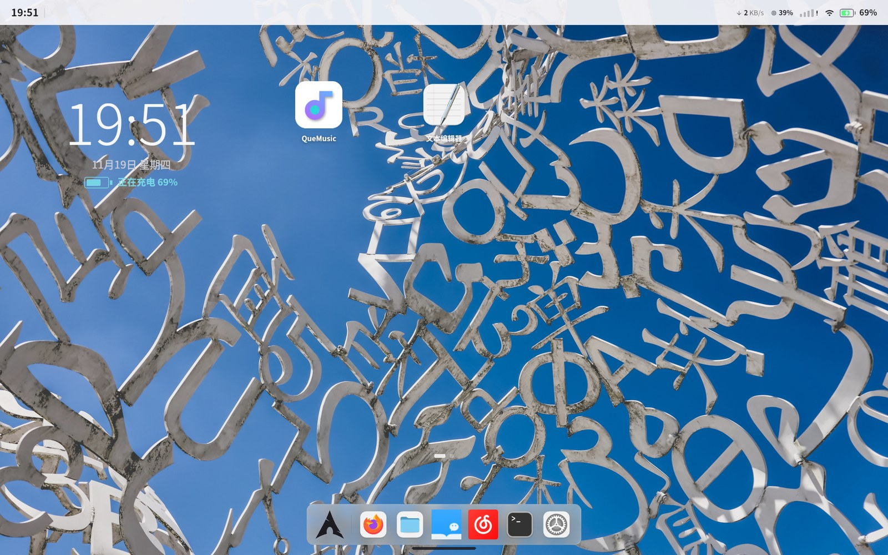
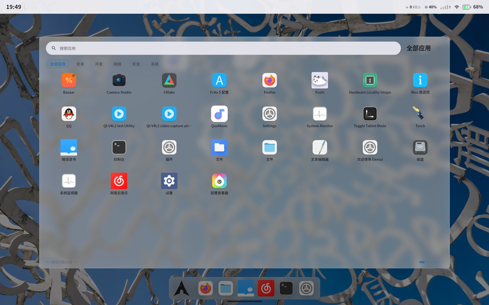
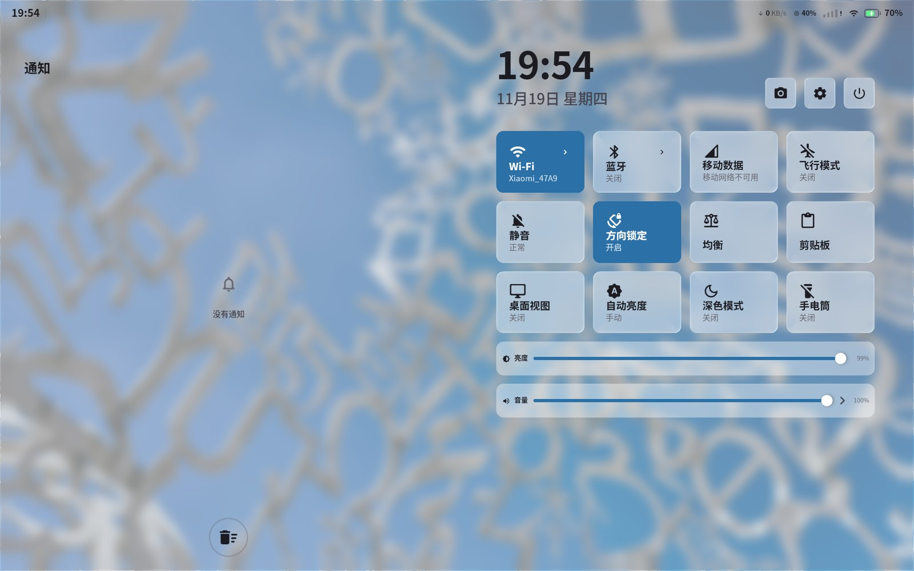
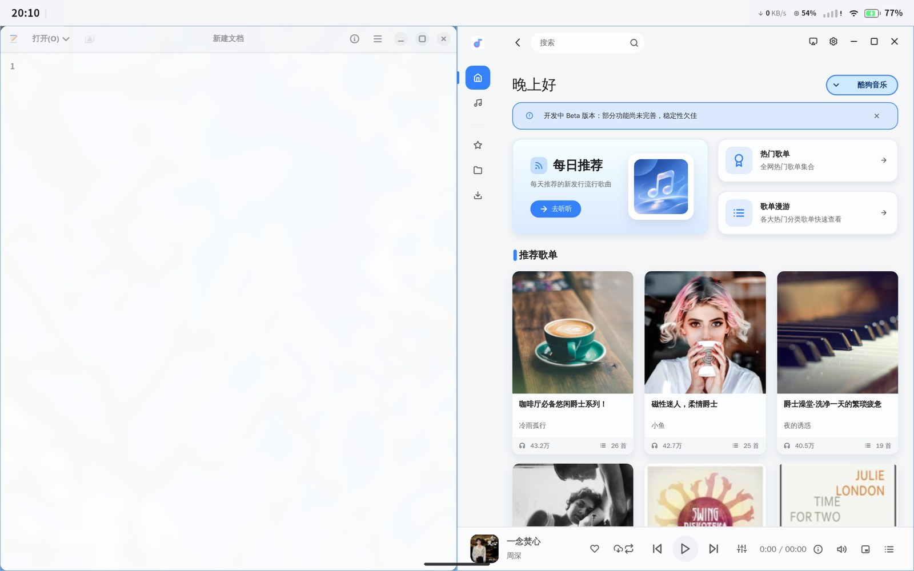

<h1 align="center">
  <picture>
    <source media="(prefers-color-scheme: dark)" srcset="assets/branding/denial-dark.svg">
    
  </picture>
</h1>

<p align="center"><strong>把 Denial 装进平板：一套触屏优先的移动外壳。</strong></p>

<p align="center">
  <a href="LICENSE"></a>
  
  
</p>

<p align="center">
  <a href="#这是什么">这是什么</a> ·
  <a href="#与上游的区别">与上游的区别</a> ·
  <a href="#手势">手势</a> ·
  <a href="#构建">构建</a> ·
  <a href="#部署到平板">部署</a> ·
  <a href="docs/README.md">文档</a>
</p>

| 主页就是桌面文件夹 | 全部应用 |
| --- | --- |
| [](assets/screenshots/pad-home.jpg) | [](assets/screenshots/pad-all-apps.jpg) |
| **通知与快捷设置** | **分屏** |
| [](assets/screenshots/pad-shade.jpg) | [](assets/screenshots/pad-split.jpg) |

## 这是什么

[Denial](https://github.com/denialwm/denial) 是一个 Wayland 合成器，默认外壳面向桌面：鼠标、多显示器、堆叠/平铺布局。

**Denial Pad 是它的一个 fork**，把这层外壳换成了平板形态：单屏、触控优先、以应用为中心的移动 shell，在小米平板 5（`nabu`，aarch64）上日常使用。合成器内核、协议支持、渲染管线都来自上游；改动集中在 Dart 外壳、插件和部署工具。

## 与上游的区别

| | 上游 Denial | Denial Pad |
| --- | --- | --- |
| 形态 | 桌面、多显示器、堆叠/平铺/滚动平铺 | 平板、单屏、全屏应用 |
| 主页 | 桌面图标与面板 | `~/Desktop` 文件夹即主页，图标是真实的 `.desktop` 软链 |
| Dock | 无 | 玻璃 Dock：长按抬起排序、拖出移到桌面、桌面拖入按落点插入 |
| 应用入口 | 启动器/快捷键 | 全部应用抽屉：搜索、分类分页、安卓应用单独一页 |
| 多任务 | 平铺布局 | 双应用分屏：拖分界线改比例、按内容自适应、每侧主题色描边 |
| 通知 | 桌面通知 | 通知中心 + 快捷设置，横幅限宽居中，动作按钮自动图标化 |
| Android | 不支持 | 通过 [droidloom](https://droidloom.org) 运行安卓应用，关闭即停止 |
| 主题 | 强调色与玻璃参数 | 内置 Colloid 图标包，可导入图标/光标主题 |
| 输入 | 鼠标键盘 | 触摸手势、虚拟键盘、手写笔 |

## 特性

**桌面与 Dock**

- 主页内容来自 `~/Desktop`：只显示 `.desktop` 快捷方式，非桌面文件一律忽略；桌面为空就只剩时钟。
- 添加/移除应用就是软链的增删，文件变化会即时刷新，不需要重启外壳。
- Dock 固定应用可长按抬起、左右拖动排序；拖出 Dock 停留 300ms 变红确认后松手，应用移到桌面（自动建软链）。
- 从桌面把图标拖回 Dock 会按落点插入，并把桌面上的那一份收走。

**应用抽屉**

- 搜索与分类并存：全部、安卓、开发、图形、网络、影音、办公、游戏、系统、其它（只显示有内容的组）。
- 单击打开，长按弹出菜单（添加到桌面等）。
- 磨砂背景 + 200ms 淡入，列表本身不随动画重建。

**分屏**

- 从最近任务把卡片拖到屏幕一侧开始分屏，方向跟随屏幕方向。
- 中间分界线可拖动改比例，双击回到 50:50。
- 客户端不跟随尺寸时按内容适配：裁掉 Android 系统栏条、比例差小于 10% 时轻微拉伸铺满。

**通知与快捷设置**

- 单行状态栏：时间、通知图标、媒体/通知滚动区、网速、内存、移动数据、Wi-Fi、蓝牙、电池。
- 通知横幅限宽居中；卡片默认展开，动作按钮能从 `trash`、`lyric` 这类短键映射成图标。
- 快捷设置磁贴、亮度/音量滑块、音量输出设备选择（与其它弹窗同样的磨砂）。

**系统**

- 锁屏 PIN、双击桌面息屏、电源键策略。
- 截图保存为 `Screenshot-年月日时分秒.png`。
- 关闭应用即退出：安卓应用走 `force-stop`，原生应用在没有其它窗口时收到 `SIGTERM`。
- 息屏时把 Wi-Fi 切到省电模式，亮屏恢复，避免交互延迟。

## 手势

| 动作 | 结果 |
| --- | --- |
| 底部上滑 | 回到桌面；再次上滑进入最近任务 |
| 最近任务上滑卡片 | 关闭应用（并停止进程） |
| 顶部下拉 | 通知中心与快捷设置 |
| 左右边缘内滑 | 返回 |
| 桌面双击空白 | 息屏 |
| Dock 图标长按 | 抬起排序，拖出即移到桌面 |

## 构建

需要与仓库锁定的 Flutter fork、Rust 工具链和 aarch64 sysroot。初始化一次即可：

```sh
tools/denial-pc bootstrap
```

构建本机（开发机）使用的合成器与外壳：

```sh
tools/denial-pc build          # 外壳 + 合成器 + denialctl
tools/denial-pc bundle        # 只构建 Flutter 外壳
```

生成 aarch64 的 Arch Linux 包（用于平板安装）：

```sh
./build-aarch64-package.sh
```

交叉构建的细节见 [docs/BUILDING.md](docs/BUILDING.md) 和 [CROSS_BUILDING.md](CROSS_BUILDING.md)。

## 部署到平板

`tools/denial-deploy-bundle` 会整包构建、传输、校验并重启平板：

```sh
export DENIAL_TARGET_ARCH=aarch64
export DENIAL_ARM64_SYSROOT="$HOME/.cache/denial/arm64-sysroot"
export DENIAL_PC_PACKAGE_ROOT="$PWD"
export DENIAL_TABLET_HOST=user@<tablet>
export DENIAL_TABLET_KEY="$HOME/.ssh/<key>"
./tools/denial-deploy-bundle
```

脚本做三件事保护设备：传输后比对整包 sha256、安装后逐字节校验每个库、重启后再校验一次引擎哈希。任何一步不符会直接停下，而不是留下一个黑屏的平板。

常用开关：`--no-build`（只传输现有构建）、`--compositor`（带上 `deniald`）、`--no-reboot`。

## 项目结构

```
compositor/        Wayland 合成器（Rust，来自上游）
dart_shell/        Flutter 外壳入口
packages/          共享 Dart 包（SDK、协议）
plugins/denial_desktop/   移动 shell 的主体：主页、Dock、抽屉、分屏、通知、设置
settings_app/      独立设置应用
tools/             构建、部署与设备辅助脚本
docs/              设计稿、构建说明与已知问题
```

## 已知问题

- [docs/KNOWN_ISSUES.md](docs/KNOWN_ISSUES.md)：设备上观察到、但不在本仓库范围内的问题（例如 droidloom 的 adbd 每两秒重连）。
- [MISTAKE.md](MISTAKE.md)：踩过的坑与修复记录。

## 许可证

沿用上游：GPL-3.0-or-later，见 [LICENSE](LICENSE)。

合成器、渲染与协议实现归 [Denial](https://github.com/denialwm/denial) 的作者；平板外壳与相关工具维护在本仓库。
